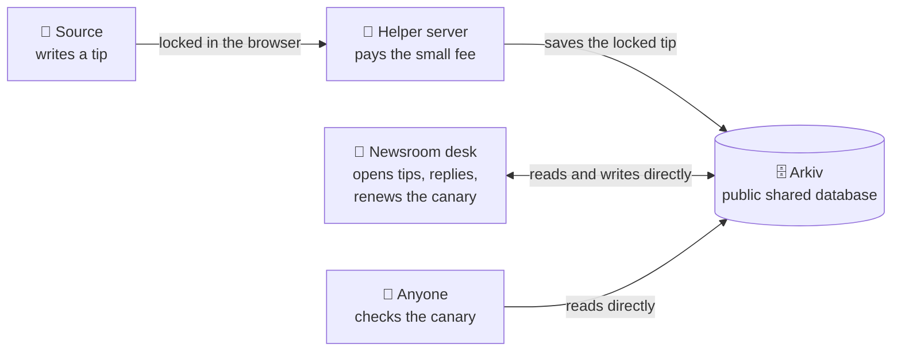
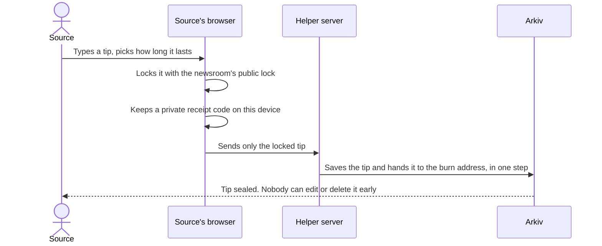
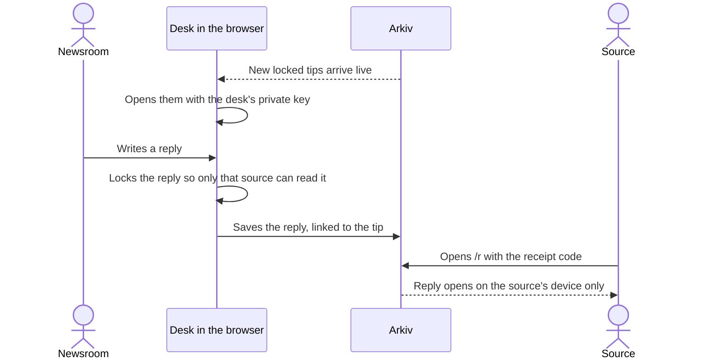
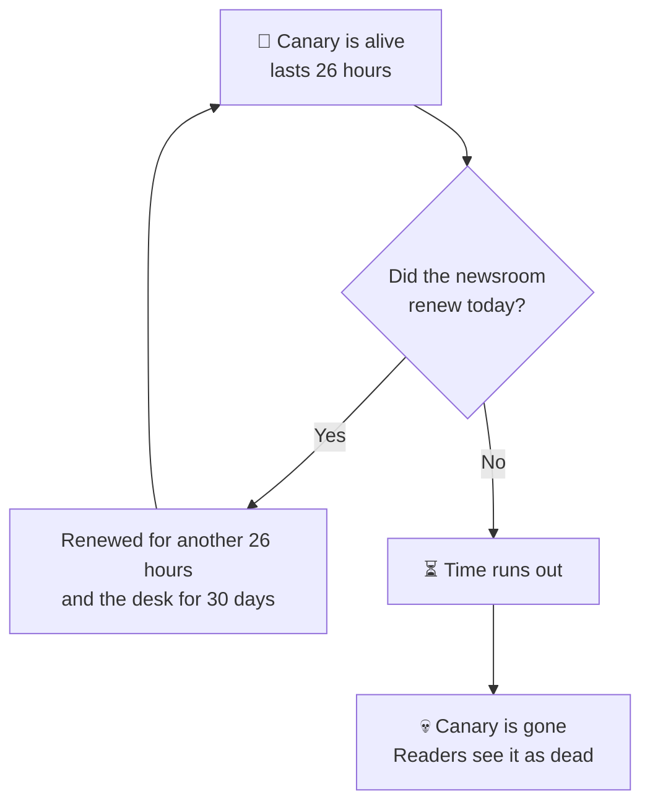

<div align="center">

# 🐤 CanaryDrop

### Tips no one can seize. Canaries no one can fake.

A safe tip line for small newsrooms. Sources send a locked message that only the newsroom can open,<br/>
and the newsroom keeps a daily "we are fine" signal alive that goes quiet on its own if they are silenced.

**[Open the live app](https://canarydrop.vercel.app)** · **[See the live proof](https://canarydrop.vercel.app/how)** · **[Watch the 2 minute demo](https://youtu.be/GLdnWb50eVI)** · **[Check it in 60 seconds](https://canarydrop.vercel.app/verify)**

Built for the Arkiv hackathon, Privacy track. Runs on the Arkiv Tiramisu test network.

</div>

---

## Who it is for

- **Sources and whistleblowers** who want to tell a newsroom something without an account, a wallet, or their name.
- **Small newsrooms** that cannot afford a security team but still need a tip line that cannot be quietly seized or edited.
- **Readers** who want a simple way to check that a newsroom has not been gagged.

## The idea in plain words

**1. A tip locked on your device.** You write a tip in your browser. Your browser locks it with the newsroom's public lock before it leaves your device. Only the newsroom's private key can open it. Nobody in between can read it, including us.

**2. A tip nobody can tamper with.** The locked tip is saved on Arkiv, a public shared database. In the same step it is handed to a "burn" address that nobody controls (`0x…dEaD`). After that, nobody can change it, delete it early, or keep it around longer. It disappears when the time the source picked runs out: 1 hour, 24 hours, 3 days or 7 days.

**3. A canary that dies on its own.** A warrant canary is a public "we have not been gagged" notice. On CanaryDrop it lasts 26 hours. The newsroom renews it every day. If they stop, because they were forced to, it simply expires. Silence is the signal, and nobody has to announce anything.

**4. Only the real newsroom counts.** Every page only trusts records written by the newsroom's own wallet (its account on the network). A copycat that uses the same name from a different wallet is ignored. We even made one on purpose to prove it.

**5. Private replies.** The newsroom can answer a tip. The source reads the answer at `/r` with a private receipt code that only lives on their device.

## How it fits together



The helper server only ever sees a locked message. It never sees the words. The newsroom and readers talk to Arkiv straight from the browser, so there is no middle service that could be switched off to hide things.

## Sending a sealed tip



Sources do not need a wallet. The helper server pays the tiny network fee. The app also has a path where the browser makes a throwaway key and sends the tip itself, so no helper is needed.

## The desk opening and replying



The desk key stays in the newsroom's browser, with a backup file they download. Tips are opened on screen and nowhere else.

## Renewal and expiry



Only the newsroom's wallet can renew its canary. We deliberately did not turn on the setting that lets anyone extend it, because then anyone could fake a live canary.

## See it for yourself

No wallet and nothing to install.

1. Open **[/verify](https://canarydrop.vercel.app/verify)**, the 60 second check.
2. Open the public canary page. It says ALIVE when the demo desk has been renewed.
3. Open **Submit**, write a made up sentence, and send it. The helper pays the fee.
4. Open **Explorer** and find your tip. Sealed tips show the burn address as their owner.
5. Open **[How we use Arkiv](https://canarydrop.vercel.app/how)**. Every claim on that page is a live read from the network, with links.
6. Optional: open **Desk** and turn on Demo mode. A fresh browser loads a shared test desk key so you can open tips. Demo mode is for trying it out only, never for a real newsroom.

## Real proof on the network

All test data. Every link opens the Arkiv Tiramisu explorer.

**From the final demo video**

| What happened | Link |
|---|---|
| A tip saved and sealed to the burn address in one step | [0x1f346fd0…](https://tiramisu.explorer.arkiv.network/tx/0x1f346fd07f0e4bd999d85989d025e4acf1038118b17545d28c112455ce7ae0f4) |
| The newsroom's private reply | [0xa836f6c2…](https://tiramisu.explorer.arkiv.network/tx/0xa836f6c2b1a91993a8f4fe1f8d62478006277ffc33edcbf12dd1d179c50f5e2e) |
| Canary renewed for 26 hours and desk for 30 days, together | [0xcc5fb82f…](https://tiramisu.explorer.arkiv.network/tx/0xcc5fb82f259d13c0c56c48dcd0d7b9291c230c50eda353260d96ba2d2b0ddf41) |

**Earlier records**

| What happened | Link |
|---|---|
| First desk and canary created together | [0x6558bfd2…](https://tiramisu.explorer.arkiv.network/tx/0x6558bfd29237fd4b131fbee1d74f13ac3ce1152d88a5ae05d24d5f33a1dc35be) |
| Current demo desk and canary, made with the shared demo key | [0xb34a7d5a…](https://tiramisu.explorer.arkiv.network/tx/0xb34a7d5a4b492aecc3b0cdfa5a298e8cf9a968fcf67ac83787d486b4c08d5527) |
| Sealed tips | [0xfba666e2…](https://tiramisu.explorer.arkiv.network/tx/0xfba666e2ed91c4cd35f0020959cfe48520247f3ab6a96efa1b5e0ed2868744d9) · [0x2401d9b5…](https://tiramisu.explorer.arkiv.network/tx/0x2401d9b57ae4545d4f2aee716476db731bcd7cc260c9c1ae42f1ec5e0b6df83c) · [0x96c37ab0…](https://tiramisu.explorer.arkiv.network/tx/0x96c37ab0a3592f02abe6ac75565fb5b0c400bb451156d2c156246728f3fc886f) |
| Earlier reply | [0x33723440…](https://tiramisu.explorer.arkiv.network/tx/0x3372344033724934a4e5cd09d9512fc1cf5cf221a5e05f11daecd814055227c1) |
| Earlier renewal | [0x348fcd83…](https://tiramisu.explorer.arkiv.network/tx/0x348fcd830adef7e6cbf5e8201d425e208ef01be8cc6321e41bfa1a6b5f5df466) |
| A fake copycat desk the app correctly ignores | [0x95341857…](https://tiramisu.explorer.arkiv.network/tx/0x953418573cb61d2e3174f1729162d0ee76e280c43e3633ccba3956b500ff4706) |

**Test wallets** (public addresses only)

| Role | Address |
|---|---|
| Helper server (pays fees for tips) | [`0xa6Aa6a1409eb54028550466169A29EAfd8f7a442`](https://hub.arkiv.network/tiramisu/address/0xa6Aa6a1409eb54028550466169A29EAfd8f7a442) |
| Demo newsroom desk | [`0x1da3c22c079c264536D831F6F1fCe638aB0b20B0`](https://hub.arkiv.network/tiramisu/address/0x1da3c22c079c264536D831F6F1fCe638aB0b20B0) |
| Copycat (for the test only) | [`0x97250dcDbE5fB229Fb532AAC0d62be44e028b7Af`](https://hub.arkiv.network/tiramisu/address/0x97250dcDbE5fB229Fb532AAC0d62be44e028b7Af) |

## What stays off Arkiv, on purpose

- The words of any tip. Only the locked version is saved.
- Private keys. The desk key stays in the newsroom's browser. The receipt code stays on the source's device.
- IP addresses (the number that identifies your internet connection). The helper writes none to Arkiv. The hosting platform may still log them, so use Tor Browser if that matters to you. The site shows a gentle reminder when you are not on Tor.
- Names or identities of sources.

## Extra features

- **Verified domain.** The site publishes its desk address at `/.well-known/canarydrop.json`, and a DNS record can say the same. Pages show a Verified domain badge when they match, and flag a desk that does not.
- **Dead drop on silence** (demo, test data only). A newsroom can seal a statement in advance for chosen people. A "hold" record lives as long as the canary. If the canary dies, the statement is treated as released.
- **Signed canary statements.** The canary statement can carry a signature from the desk wallet that anyone can check offline.
- **A copy you can host yourself.** The whole site can be built as plain files that anyone can host, with a published list of file fingerprints so you can check you got the exact same build. See [docs/static-build.md](docs/static-build.md).

## Pages in the app

| Page | What it is |
|---|---|
| `/` | Home and short explainer |
| `/submit` | Send a tip, pick the newsroom |
| `/d/[wallet]` | A newsroom's public page with its canary and tip form |
| `/r` | Read a reply with your receipt code |
| `/canary/[wallet]` | A newsroom's public canary status |
| `/desk` | The newsroom's desk: inbox, replies, canary, dead drop, settings |
| `/explorer` | Live feed of CanaryDrop records on the network |
| `/how` | Live proof of every Arkiv feature we use |
| `/verify` | The 60 second check |
| `/threat` | What we protect, what we do not, and why Tor helps |
| `/docs` | Data layout and notes |

## More reading

| File | What is inside |
|---|---|
| [SECURITY.md](SECURITY.md) | What we protect, what we do not, in plain words |
| [arkiv/schema.md](arkiv/schema.md) | Exactly what we save on Arkiv and the questions we ask it |
| [arkiv/friction.md](arkiv/friction.md) | Problems we hit building on Arkiv, each with a script to reproduce it |
| [docs/friction.md](docs/friction.md) | Things Arkiv does not offer yet, written as suggestions |
| [docs/static-build.md](docs/static-build.md) | Building and checking the self hosted copy |
| [arkiv/evidence/README.md](arkiv/evidence/README.md) | Where the on chain proof files live |

---

## For developers

Everything below is technical.

### Stack

Next.js 14, React 18, `@arkiv-network/sdk` 0.8.1, viem, zod, Upstash Redis (optional). Node 24.22.0 (see `.nvmrc`).

Arkiv calls live in `lib/arkiv.ts` and `lib/relay.ts`. Browser encryption lives in `lib/crypto.ts`: P-256 ECDH, then HKDF-SHA256, then AES-256-GCM, with tip text padded to 2 KiB buckets so length leaks less.

### Run it locally

```bash
nvm use        # Node 24.22.0
npm ci
npm run dev    # http://localhost:3000
```

Create `.env.local` with testnet values. Never commit this file.

```bash
# Server only. Pays fees for tips.
RELAY_PRIVATE_KEY=0x...
# Optional. Enables Demo mode (server signed desk writes).
DESK_PRIVATE_KEY=0x...
# Public addresses used by the creator filters.
NEXT_PUBLIC_RELAY_ADDRESS=0xa6Aa6a1409eb54028550466169A29EAfd8f7a442
NEXT_PUBLIC_DESK_ADDRESS=0x1da3c22c079c264536D831F6F1fCe638aB0b20B0
# Optional shared rate limits and wallet locks.
# UPSTASH_REDIS_REST_URL / UPSTASH_REDIS_REST_TOKEN (or KV_REST_API_URL / KV_REST_API_TOKEN)
# Optional server only RPC override. Must stay on the Tiramisu host.
# ARKIV_RPC_URL=
```

Without the Redis values the app still runs. Limits and locks stay in that one process and one warning is logged.

### Check the live data without any keys

```bash
npm ci
NEXT_PUBLIC_DESK_ADDRESS=0x1da3c22c079c264536D831F6F1fCe638aB0b20B0 \
NEXT_PUBLIC_RELAY_ADDRESS=0xa6Aa6a1409eb54028550466169A29EAfd8f7a442 \
npm run verify
```

### Scripts

| Command | What it does |
|---|---|
| `npm run dev` / `build` / `start` | Usual Next.js commands |
| `npm run lint` / `typecheck` | Code checks |
| `npm test` | Unit, API and integration tests (vitest) |
| `npm run test:e2e` | Browser tests (Playwright) |
| `npm run verify` | Read only check against live Tiramisu |
| `npm run friction` | Runs every repro in `arkiv/repro/` (read only, no wallet) |
| `npm run renew` | Renews the demo canary, desk and dead drop holds. Dry run unless `DRY_RUN=0`, needs `DESK_PRIVATE_KEY` |
| `npm run build:static` | Builds the self hostable copy into `out/` |
| `npm run verify:static -- expected.sha256` | Rebuilds and compares file fingerprints |
| `npm run repro:hash` | Builds twice and compares |

Write routes also accept a dry run: add `?dryRun=1` or header `x-dry-run: 1` to simulate without sending.

### Deploying on Vercel

Set `RELAY_PRIVATE_KEY`, `NEXT_PUBLIC_RELAY_ADDRESS`, `NEXT_PUBLIC_DESK_ADDRESS`, and optionally `DESK_PRIVATE_KEY` plus the Redis REST values, for Production and Preview. Production: https://canarydrop.vercel.app

### Network

| | |
|---|---|
| Chain | Tiramisu testnet, id `7738577` (`0x7614d1`) |
| RPC | `https://rpc.tiramisu.db-chain.testnet.arkiv.network` |
| WebSocket | `wss://rpc.tiramisu.db-chain.testnet.arkiv.network` |
| Fee token | GLM |
| Explorer | https://hub.arkiv.network/tiramisu |
| Project tag on every record | `canarydrop-gts26-hm` |

### Safety limits in the server

Write routes need an allowed Origin and a matching CSRF token. The helper checks the desk is real and live before paying. Daily caps are counted on Arkiv itself (120 tips, 40 replies, 10 demo desk creates per UTC day), and writes stop if the wallet drops below 0.02 GLM. Locked tips are capped at 8192 bytes. Full detail in [SECURITY.md](SECURITY.md).

### How AI was used

The UI was styled against a provided "Neural Pathway" motion design brief. Coding assistants helped scaffold pages, CSS and boilerplate. Arkiv calls were written against the SDK source and docs, and the encryption uses the browser's built in WebCrypto with round trip tests.

### Hackathon checklist

MIT license (`LICENSE`) · live URL above · `arkiv/schema.md` · `arkiv/friction.md` with repro scripts · wallet addresses listed · test data only · sources need no wallet · canary renewal built and documented · built Oct 9 to 18, 2026, no earlier work.

## License

MIT. See [LICENSE](LICENSE).
